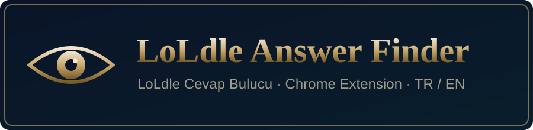
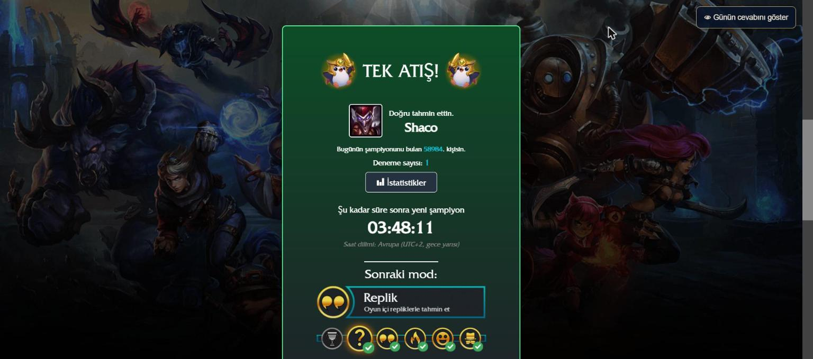
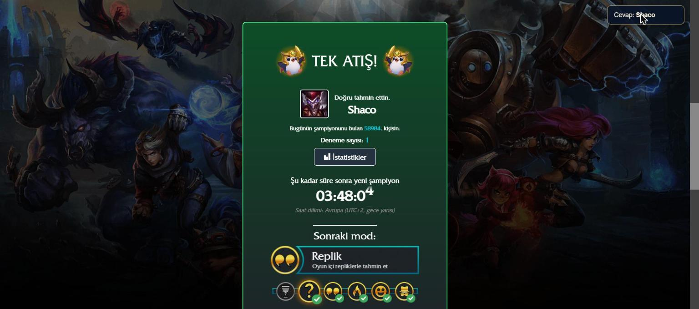

# LoLdle Answer Finder

**English** | [Türkçe](README.tr.md)

A small Chrome extension that reads today's [LoLdle](https://loldle.net) answer directly from the page and shows it to you.

## Features

- Shows today's champion for every mode: Classic, Quote, Ability, Emoji, Splash
- **Ability mode:** shows the correct key (Passive / Q / W / E / R) and ability name
- Highlights the right button in the bonus question and can answer it with one click
- Floating on-page box, hidden by default — click it to reveal or hide the answer (no accidental spoilers)
- Popup from the toolbar icon for a quick look
- **Automatic language:** the interface is in Turkish if your system/browser language is Turkish, otherwise English

## Screenshots

| Hidden by default | Click to reveal |
| --- | --- |
|  |  |

The box in the top-right corner stays hidden until you click it, so you don't get spoiled by accident.

## Installation

1. Download this repository (**Code → Download ZIP**) and extract it, or clone it:
   ```bash
   git clone https://github.com/YasefDogan/loldle-cevap-bulucu.git
   ```
2. Open `chrome://extensions` in Chrome (works in Edge, Brave, Opera too).
3. Turn on **Developer mode** (top right).
4. Click **Load unpacked** and select the extracted folder.

## Usage

1. Go to [loldle.net](https://loldle.net) and pick a mode.
2. Click the **👁 Show today's answer** box in the top-right corner of the page,
   or click the extension icon in the toolbar.
3. In Ability mode, after you find the champion, use **Answer bonus** to pick the right key.

## How it works

LoLdle does not send today's answer as plain text — it arrives **hashed/encrypted**. But the game has to check your guesses **in the browser**, so the site also ships everything needed to decode it: the key and the decryption logic live in the page's HTML/JavaScript. Anything the browser can decrypt, the user can decrypt too.

So the extension doesn't break any encryption, it just reads what the page has already decoded:

1. **The answer is in the page.** On load, the site uses the key in its own code to decrypt the encrypted answer and stores the result in memory.
2. **LoLdle is a Vue app.** Every Vue component keeps a reference to itself on its DOM element (`element.__vue__`).
3. **Walking the tree.** The extension finds the first Vue component in the page, climbs up to the root via `$parent`, then visits every component through `$children`.
4. **Reading the data.** While walking, it picks up these fields from each component's `$data`:
   - `todayAnswerDecrypted` → today's champion (already decrypted by the site)
   - `abilityLetter` → the correct key in Ability mode (P/Q/W/E/R)
   - `abilityName` → the ability's name
5. **Bonus question.** It finds the right button among `.letters-container .letter-picker` and highlights it or clicks it for you.
6. The content script runs in the page's own JavaScript context (`"world": "MAIN"`), which is what makes `__vue__` accessible. Because the site is a single-page app, it re-checks every second as you switch modes.

> In short: **client-side "hiding" isn't security.** If the key is shipped to the browser, the answer can be read. The only real fix would be checking guesses on the server.

It makes no network requests and collects no data — everything happens inside your own browser tab.

## Files

| File | Purpose |
| --- | --- |
| `manifest.json` | Extension manifest (MV3) |
| `content.js` | Floating answer box on loldle.net |
| `popup.html` / `popup.js` | Toolbar popup |
| `_locales/` | Extension name/description in Turkish and English |

## Disclaimer

This is an unofficial fan project and is not affiliated with LoLdle or Riot Games. It is for fun — using it spoils the game, so use it wisely. If the site changes its structure, the extension may stop working.
